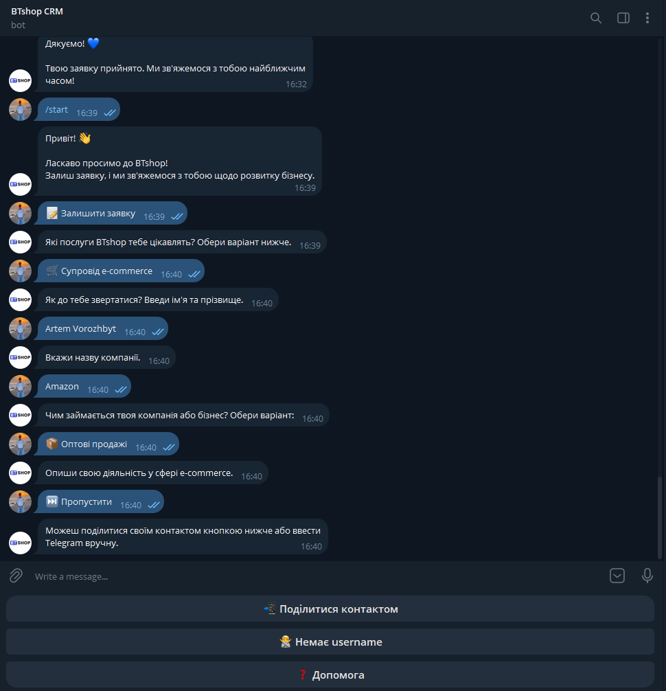
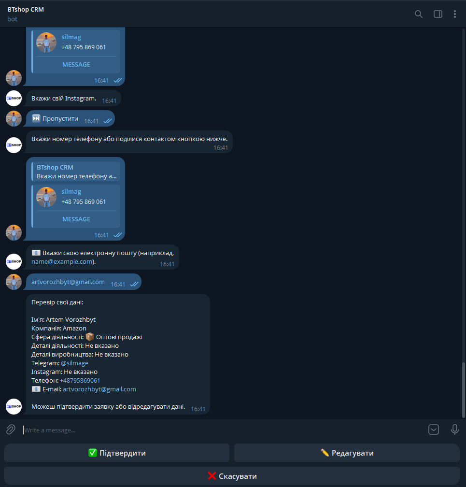
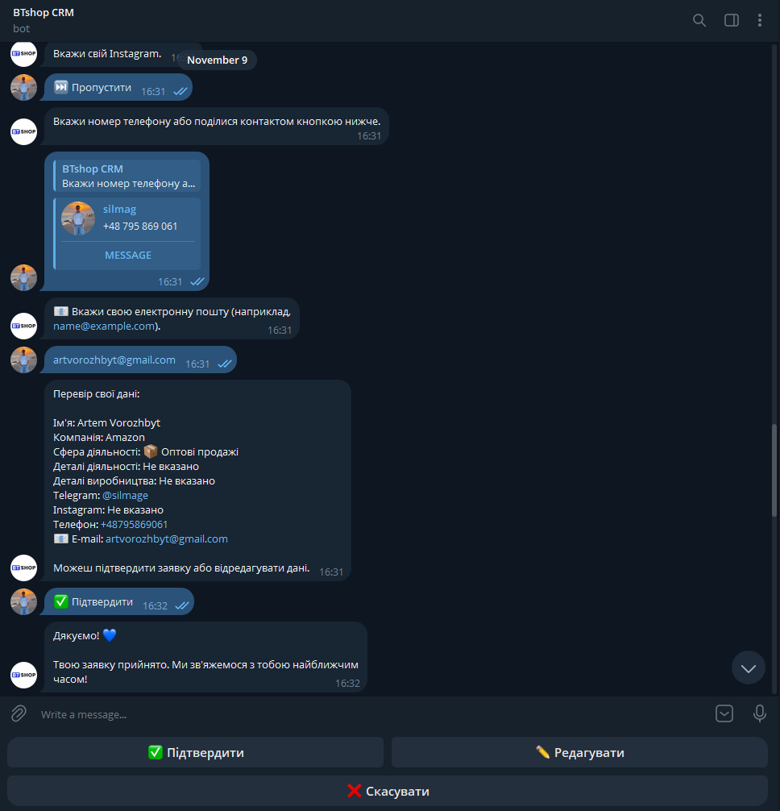
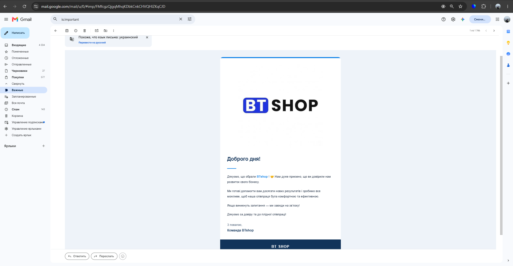
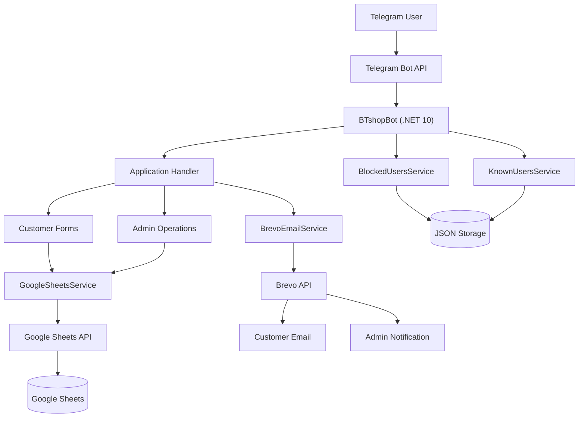

# BTshopBot — Telegram CRM Assistant

<p align="center">
  <strong>A Telegram-based CRM automation bot built with C# and .NET 10.</strong>
  <br />
  Automates customer onboarding, application collection, Google Sheets integration, and email notifications.
</p>

<p align="center">
  
  
  
  
  
</p>

---

## Overview

**BTshopBot** is a Telegram CRM automation solution developed for BTshop, a business providing e-commerce and marketplace-related services.

The bot automates the process of collecting customer information and transferring it to a centralized Google Sheets database.

Instead of manually collecting customer details, employees can receive structured applications directly through Telegram.

The project demonstrates practical backend development with C#, asynchronous programming, third-party API integrations, data persistence, error handling, and cloud deployment.

## Key Features

### Customer Application Flow

- Interactive, step-by-step application form.
- Service selection:
  - Full BTshop Package
  - Product Import
  - E-commerce Support
  - Other Services
- Collection of customer information:
  - Full name
  - Company name
  - Business industry
  - Business and production details
  - Telegram username
  - Instagram username
  - Phone number
  - Email address
- Optional fields can be skipped.
- Phone number and email validation.
- Telegram contact sharing.
- Application summary before submission.
- Ability to edit previously entered information.
- Application cancellation.

### Google Sheets Integration

- Automatic application submission to Google Sheets.
- Structured storage of customer information.
- Automatic identification of the next available row.
- Telegram usernames converted into clickable Telegram links.

### Email Notifications — Brevo

- Automatic confirmation email to customers after successful submission.
- Email notification to the administrator when a new application is received.
- HTML email templates.
- Separate error handling for email delivery.

### Administration Panel

- Restricted access based on Telegram user ID.
- Manual customer creation.
- Customer blocking and unblocking.
- List of blocked users.
- Notifications about first-time bot users.

### Additional Features

- Help section with usage instructions.
- Paid consultation information.
- Persistent storage of blocked and previously registered user IDs using JSON files.

**Interface language:** Ukrainian.

---

## Screenshots

The following screenshots demonstrate the customer journey and email integration.

### 1. Application Process



### 2. Application Summary

Customers can review their information, edit fields, or cancel the application before submission.



### 3. Successful Submission

After confirmation, the application is saved to Google Sheets.



### 4. Email Confirmation

Customers receive an automatic confirmation email through Brevo.



---

## Architecture

The application uses a modular service-based structure.



### Main Components

| Component | Responsibility |
|---|---|
| `Program.cs` | Application entry point, Telegram updates, command handling, customer forms, and administration logic |
| `GoogleSheetsService.cs` | Google Sheets API integration and application storage |
| `BrevoEmailService.cs` | Email notifications and HTML email templates |
| `BlockedUsersService.cs` | Managing blocked Telegram users |
| `KnownUsersService.cs` | Tracking first-time users and preventing duplicate notifications |

---

## Tech Stack

| Technology | Purpose |
|---|---|
| C# | Backend programming language |
| .NET 10 | Application runtime and framework |
| Telegram.Bot 22.10.3.3 | Telegram Bot API integration |
| Google Sheets API | Customer data storage |
| Google.Apis.Sheets.v4 | Google Sheets .NET client |
| Brevo API | Transactional email delivery |
| JSON | Local persistence of user-related data |
| Google Cloud Compute Engine | Cloud hosting |
| Ubuntu 24.04 | Server operating system |
| systemd | Application process management |
| Git & GitHub | Version control and source code hosting |

---

## Project Structure

```text
BTshopBot/
│
├── Program.cs
├── GoogleSheetsService.cs
├── BrevoEmailService.cs
├── BlockedUsersService.cs
├── KnownUsersService.cs
│
├── Properties/
│
├── secrets/
│   └── google-service-account.json
│
├── data/
│   ├── blocked-users.json
│   └── known-users.json
│
├── .gitignore
├── BTshopBot.csproj
└── README.md
```

> **Note:** The `secrets/` and `data/` directories contain runtime files. Credentials and private data must not be committed to the repository.

---

## Getting Started

### Prerequisites

Make sure you have:

- [.NET 10 SDK](https://dotnet.microsoft.com/download/dotnet/10.0)
- A Telegram bot token from [@BotFather](https://t.me/BotFather)
- A Google Cloud project with Google Sheets API enabled
- A Google Service Account with access to the target spreadsheet
- A Brevo account and API key (for email notifications)

### 1. Clone the Repository

```bash
git clone https://github.com/Artemvorozhbyt/BTshopBot.git

cd BTshopBot
```

### 2. Restore Dependencies

```bash
dotnet restore
```

### 3. Configure Environment Variables

The application uses environment variables to store sensitive configuration.

**Required:**

| Variable | Description |
|---|---|
| `BTSHOP_TELEGRAM_TOKEN` | Telegram bot token |
| `BTSHOP_BREVO_API_KEY` | Brevo API key |

The Brevo integration is optional. Without its API key, the bot can still operate, but email notifications will be unavailable.

Example for Linux:

```bash
export BTSHOP_TELEGRAM_TOKEN="your_telegram_bot_token"
export BTSHOP_BREVO_API_KEY="your_brevo_api_key"
```

For Windows PowerShell:

```powershell
$env:BTSHOP_TELEGRAM_TOKEN = "your_telegram_bot_token"
$env:BTSHOP_BREVO_API_KEY = "your_brevo_api_key"
```

### 4. Configure Google Sheets

1. Create a Google Cloud project.
2. Enable the Google Sheets API.
3. Create a Service Account.
4. Generate a JSON credentials file.
5. Place the credentials file at:

```text
secrets/google-service-account.json
```

6. Share your Google Spreadsheet with the Service Account email address.
7. Grant it Editor access.

The spreadsheet must contain a worksheet named:

```text
Лист1
```

The application writes customer information into columns `A:J`.

### 5. Configure Application Settings

Before running the bot, verify the following settings in `Program.cs`:

- Google Spreadsheet ID.
- Administrator Telegram ID.
- Google credentials file path.
- Brevo sender configuration and administrator notification recipient.

Do not commit private credentials or production-specific sensitive configuration.

### 6. Build and Run

Build the application:

```bash
dotnet build -c Release
```

Run it:

```bash
dotnet run
```

The terminal should display:

```text
Bot started: @YourBotUsername
Press Ctrl+C to stop the bot.
```

Your bot is now running.

---

## Deployment

The bot is deployed using **Google Cloud Compute Engine**.

### Production Environment

| Component | Configuration |
|---|---|
| Cloud Provider | Google Cloud |
| Service | Compute Engine |
| Operating System | Ubuntu 24.04 LTS |
| Runtime | .NET 10 |
| Process Manager | systemd |
| Execution Model | Telegram Long Polling |

### systemd Service

The bot runs as a Linux systemd service, allowing it to start automatically after server restarts.

Example service configuration:

```ini
[Unit]
Description=BTshopBot Telegram CRM Bot
After=network-online.target
Wants=network-online.target

[Service]
Type=simple
User=YOUR_LINUX_USER
WorkingDirectory=/path/to/BTshopBot
EnvironmentFile=/etc/btshopbot.env
ExecStart=/usr/bin/dotnet /path/to/BTshopBot/bin/Release/net10.0/BTshopBot.dll
Restart=always
RestartSec=10

[Install]
WantedBy=multi-user.target
```

### Useful Server Commands

Check service status:

```bash
sudo systemctl status btshopbot
```

Restart the bot:

```bash
sudo systemctl restart btshopbot
```

Stop the bot:

```bash
sudo systemctl stop btshopbot
```

View live logs:

```bash
sudo journalctl -u btshopbot -f
```

View the latest logs:

```bash
sudo journalctl -u btshopbot -n 100 --no-pager
```

---

## Security Considerations

The project uses several basic security practices:

- Telegram administrator access is restricted by Telegram user ID.
- API keys are stored in environment variables.
- Google Service Account credentials are stored outside version control.
- Sensitive runtime directories are excluded from Git.
- Blocked users are checked before normal bot interaction.
- Administrative operations are restricted to the configured administrator.

**Important:** Never publish Telegram tokens, API keys, Service Account JSON files, private email addresses, or real customer information.

---

## Error Handling and Reliability

The application includes:

- Validation of customer input.
- Exception handling for Google Sheets operations.
- Separate exception handling for email delivery.
- Logging of Telegram polling errors.
- Automatic process restart through systemd.
- Persistent storage of blocked and known user IDs.

Email delivery errors do not prevent an already saved application from being accepted.

---

## Roadmap

The following are potential improvements, not claims about currently implemented functionality:

- [ ] Multi-language interface (Ukrainian, Polish, English).
- [ ] Improved application state management.
- [ ] Automated tests.
- [ ] Structured logging.
- [ ] More advanced customer management.
- [ ] Database-backed customer storage.
- [ ] Web-based administration dashboard.

---

## Author

**Artem Vorozhbyt**

Junior .NET Backend Developer

Interested in backend development, C#, ASP.NET Core, API integrations, database systems, and automation.

- GitHub: [@Artemvorozhbyt](https://github.com/Artemvorozhbyt)

---

<p align="center">
  <strong>Built with C# and .NET 10</strong>
  <br />
  <sub>BTshopBot — simplifying customer communication and business workflows.</sub>
</p>
